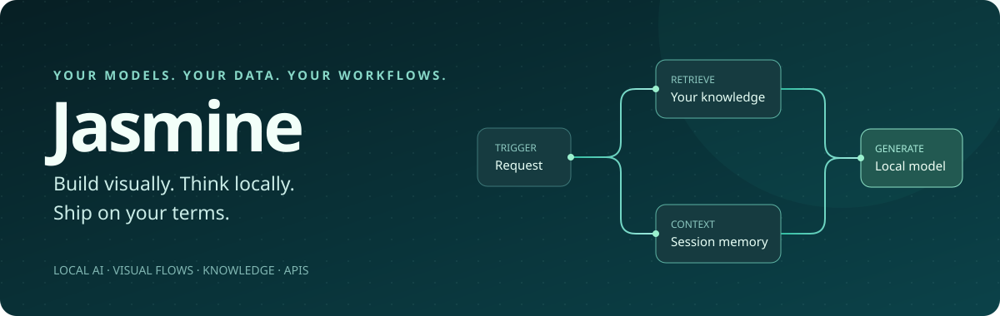
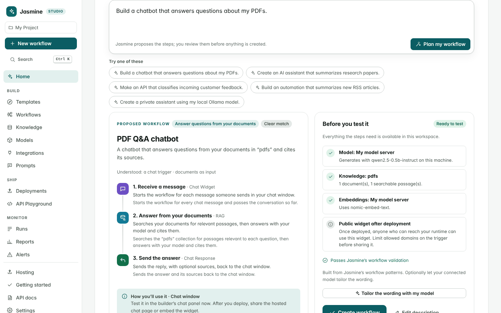
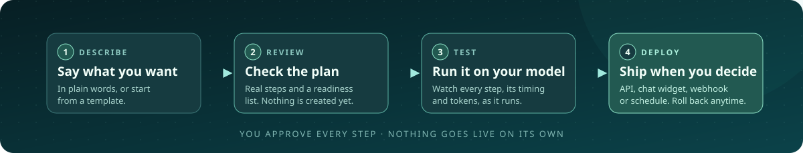
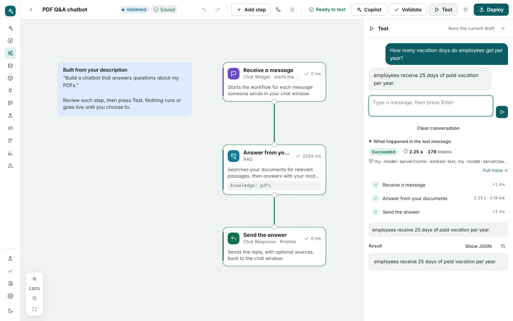
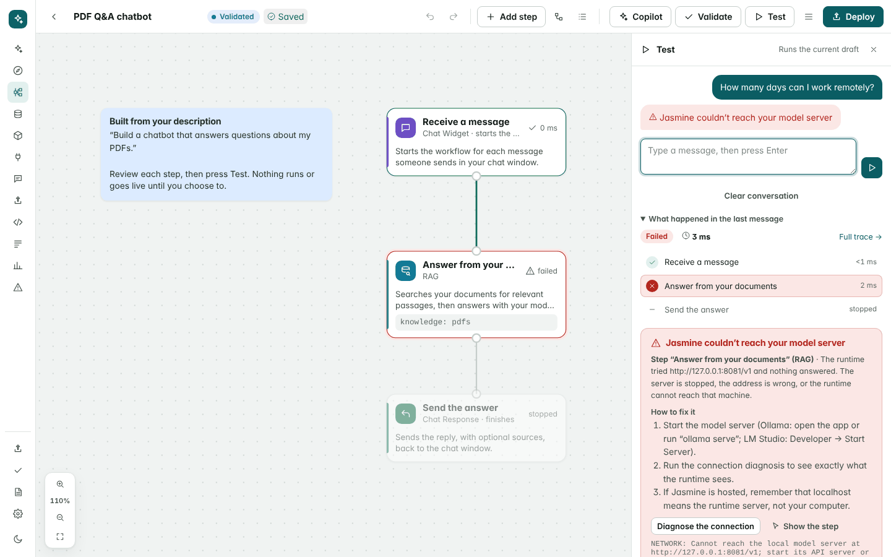
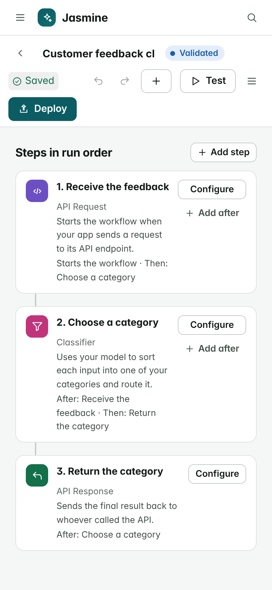
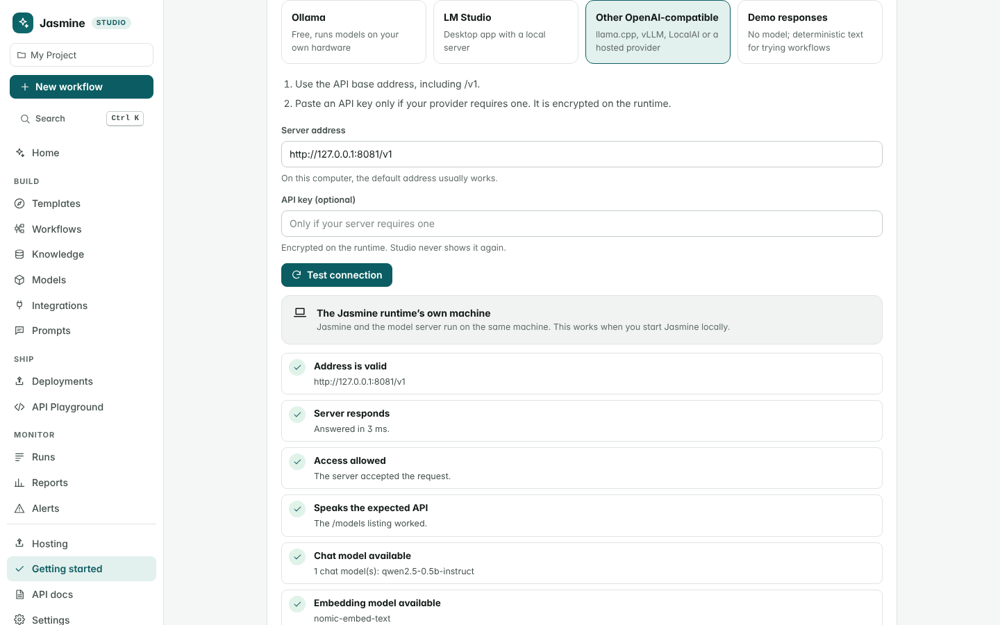
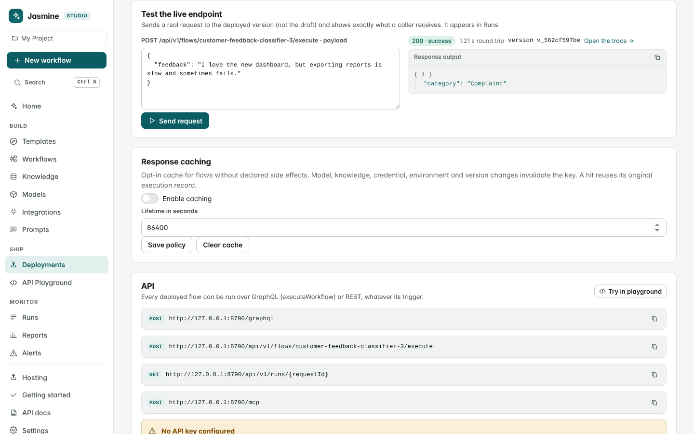

<p align="center"></p>

<p align="center">
  <a href="#quick-start"></a>
  
  <a href="#connect-a-model"></a>
  <a href="#built-to-be-inspected"></a>
</p>

<h3 align="center">Describe what you want to build.<br>Jasmine turns it into a workflow that actually runs.</h3>

<p align="center">
  <a href="#quick-start"><b>Quick start</b></a> ·
  <a href="#what-you-can-build">What you can build</a> ·
  <a href="#how-it-works">How it works</a> ·
  <a href="#connect-a-model">Connect a model</a> ·
  <a href="#deploy-and-share">Deploy</a> ·
  <a href="#give-your-application-an-api">API</a> ·
  <a href="#where-jasmine-runs">Hosting</a> ·
  <a href="#read-more">Docs</a>
</p>

<br>

Jasmine is a **local-first AI workflow platform**. You describe an application in plain words, or start from a template, and Jasmine proposes a workflow built from real, executable steps: a trigger, your model, your documents, your tools and a response. You review the plan, test it against your own model, watch every step as it runs, and deploy it as an API, chat window, search widget, webhook or schedule **only when you choose to**.

Your models, your data, your runtime. Jasmine runs on your machine or your server, talks to the model servers you connect (Ollama, LM Studio, llama.cpp, vLLM or any hosted OpenAI-compatible API), and never switches to a cloud model on its own.

<p align="center"></p>

## Why Jasmine?

<table>
  <tr>
    <td width="33%" valign="top">
      <h3>🏠&nbsp; Local by default</h3>
      Drafts, documents, run logs and credentials live in the runtime's data directory. Inference goes only to the model servers you connect. Jasmine never swaps in a cloud model behind your back.
    </td>
    <td width="33%" valign="top">
      <h3>🔍&nbsp; Nothing hidden</h3>
      Every step shows its status, timing, tokens and the model that answered. A failed run names the step, the likely cause and the fix. Cut-off and empty replies fail loudly instead of passing as answers.
    </td>
    <td width="33%" valign="top">
      <h3>✋&nbsp; You decide</h3>
      Plans, copilot changes, deployments, rollbacks and disabling all wait for an explicit action from you. Nothing is created or published until you say so.
    </td>
  </tr>
</table>

## Quick start

You need **Node.js 24 or newer**. Everything else arrives with `npm ci`.

```bash
git clone https://github.com/topherchris420/Jasmine.git
cd Jasmine
npm ci
npm start
```

Open **[localhost:8787](http://127.0.0.1:8787)** and pick a path:

| | Path | What happens |
| :-: | --- | --- |
| 🧭 | **Explore Jasmine** | Creates and runs a small workflow that needs no model, so you can watch a real run step by step. The chat demo uses *demo responses*: deterministic text that is clearly labelled and performs no AI inference. |
| 🔌 | **Connect my AI** | Finds model servers the runtime can reach (Ollama on 11434, LM Studio on 1234, llama.cpp/LocalAI on 8080, vLLM on 8000, and the usual Docker addresses), or takes an address you enter. It tests the connection from the runtime, lists chat and embedding models, and explains each failed check with steps to fix it. |
| 🛠️ | **Build something** | Describe what you want, or pick a template. Nothing is created until you approve the plan. |

> [!TIP]
> **Using Ollama?** Pull a chat model and an embedding model. The embedding model is what lets document search understand meaning rather than just match words.
> ```bash
> ollama pull llama3.2
> ollama pull nomic-embed-text
> ```

<details>
<summary><b>🐳 Run with Docker</b></summary>

```bash
docker compose up -d
docker compose exec ollama ollama pull llama3.2
docker compose exec ollama ollama pull nomic-embed-text
```

The compose stack runs Jasmine and Ollama, persists both in named volumes and exposes Jasmine on localhost. GPU settings are an optional section in [docker-compose.yml](docker-compose.yml).

</details>

<details>
<summary><b>🧪 No model yet? Try it with demo responses</b></summary>

Start Jasmine with `LLM_PROVIDER=mock npm start` (PowerShell: `$env:LLM_PROVIDER='mock'; npm start`). Workflows run end to end, but answers are placeholders, not AI output. Demo responses are labelled wherever they appear.

</details>

## What you can build

Type a request on the home page, or pick one of the examples. Jasmine answers with a plan you can read before anything exists.

| You type… | Jasmine proposes… |
| --- | --- |
| “Build a chatbot that answers questions about my PDFs.” | **Chat window** → retrieve passages from a knowledge collection and answer with your model, citing sources → **reply** |
| “Create an AI assistant that summarizes research papers.” | **API** → read the document you send → summarize it with your model → **return an overview and key points** |
| “Make an API that classifies incoming customer feedback.” | **API** → classifier with categories you can edit → **return the category** |
| “Build an automation that summarizes new RSS articles.” | **Daily schedule** → read the feed → write a digest with your model → **record it** (or post it to Slack or email when you ask for that) |
| “Create a private assistant using my local model.” | **Chat window** → a reply from a model server on your machine or network, pinned on the step so a hosted default connection never answers it → **reply**. Name Ollama or LM Studio to pin that server; if every connection is on the internet, the plan asks you to connect a local one. |

**The planner recognizes nine kinds of application:** document Q&A, summarization, classification, structured extraction, RSS digests, chat, chat with memory, document search and a general model-powered API. When a request is ambiguous it says how confident it is, lists its assumptions, and offers the other interpretations as one-click alternatives.

**Prefer to start from something that already works?** The **Templates** gallery has twelve ready-made workflows, each showing its use case, example input and output, and what it needs. Five run without any model at all: Your First API, Index a Web Page, Sync a Folder into a Knowledge Base, Offline document OCR and PDF page extraction.

## How it works

<p align="center"></p>

**1 · Describe and review.** The planner chooses steps only from Jasmine's catalog of 74 executable nodes, connects and arranges them, fills in sensible defaults, and checks the plan against your workspace: is a chat model connected and reachable, does the knowledge collection exist and have documents, is an embedding model available, are credentials missing, will anything become public after deployment. The plan passes through the same validation used for deployment, and any issue is shown with it. Planning is deterministic and pattern-based. If a model is connected you can optionally let it tailor the wording (names, instructions, categories); its suggestions are sanitized and cannot add steps.

**2 · Create a draft and finish setup.** *Create workflow* saves a draft. The builder keeps the readiness checklist, so a missing collection or model links straight to where you fix it.

**3 · Test with your model.** The Test panel runs the current draft and shows each step as it executes: status, elapsed time, tokens, which model was used, streamed text and the final result. Inputs are a form generated from the trigger's schema, with editable JSON for advanced use.

<p align="center"></p>

<p align="center"><sub>A real run: a local qwen2.5-0.5b-instruct model served by llama.cpp, answering from a PDF handbook indexed with nomic-embed-text.</sub></p>

**4 · See exactly what failed.** A failed run names the step, the likely cause and how to recover, keeps the original error visible, and links to the fix: diagnose the connection, create the missing collection, open the step. Steps after a failure are shown as stopped, not as failed. Failures are never hidden: a model reply that is cut off mid-stream fails the step instead of passing on a partial answer, and an empty reply is labelled as empty.

<p align="center"></p>

**5 · Deploy when you decide.** Deploy shows what will become live (an endpoint, a public widget, a webhook URL or a schedule), anything still not set up, and which version it replaces. Cancelling publishes nothing.

## Build and edit

<table>
<tr>
<td valign="top" width="66%">

- **Canvas and list view.** Drag, pan, pinch and zoom, fit to screen, and tidy the layout automatically. Every action is also available without dragging: the list view shows steps in run order with *Configure* and *Add after* buttons.
- **Plain-language steps.** The searchable palette describes what each step does (“Retrieve Knowledge — Searches your uploaded documents…”). Inputs and outputs are labelled, and connecting incompatible steps is refused with a reason. Advanced settings, retries, timeouts and the raw definition stay available.
- **Validation as you go.** Required fields, broken references and setup gaps are flagged on the step and in the Checks panel.
- **Undo, redo, autosave.** Edits save automatically with a visible status. If the connection drops or the tab closes before saving, the edits are kept in the browser and offered back when you return. Edits from another tab are detected instead of overwritten.
- **Works on a phone.** The list view is the default on small screens, so you can configure and reorder steps without a mouse.

</td>
<td valign="top" width="34%" align="center">

</td>
</tr>
</table>

<details>
<summary><b>⌨️ Keyboard shortcuts</b></summary>

| Keys | Action |
| --- | --- |
| `A` or `/` | Add a step |
| `L` | List view |
| `F` | Fit to screen |
| `Ctrl/⌘ + Enter` | Test |
| `Ctrl/⌘ + Z` / `Ctrl/⌘ + Y` | Undo / redo |
| `Ctrl/⌘ + D` | Duplicate |
| `?` | Show all shortcuts |

</details>

### Meet the copilot

The copilot answers from checks Jasmine runs against your actual workspace: the workflow, step settings, validation results, model reachability and capabilities, knowledge collections, credentials (whether they exist, never their values) and the latest run. It can diagnose a failure, explain a workflow, suggest a faster model, or propose changes such as adding document retrieval.

Proposed changes are validated and shown as a step-by-step diff. Nothing changes until you apply it, every applied change is recorded, and a change can be reverted until the workflow is edited again. A connected model can add a conversational answer from the same context. The copilot never runs, deploys or publishes anything.

## Connect a model

> [!IMPORTANT]
> Model requests always come from the **Jasmine runtime**, not from your browser. When Jasmine runs on your computer, `localhost` is your computer. When the runtime is hosted, `localhost` means the runtime's server, so a model on your laptop is not reachable unless you expose it to the runtime's network. **Connect my AI** tells you which case applies.

<p align="center"></p>

- **Ollama** uses its native API. **LM Studio, llama.cpp, vLLM, LocalAI** and hosted providers use the OpenAI-compatible API (the address includes `/v1`).
- **API keys** are encrypted on the runtime and never shown again in Studio.
- **Structured output.** Steps that need JSON use JSON-schema output. If a server rejects that format (llama-cpp-python, for example), Jasmine retries once with JSON-object mode and keeps using it for that connection while the runtime runs.
- **A model per step.** Each step can pick its own model; otherwise it uses the workspace default. **Models → Diagnose** re-runs the connection checks at any time.
- **llama-cpp-python** cancels a streamed reply whenever another request arrives, including Jasmine's status checks. Start it with `--interrupt_requests False`.

<details>
<summary><b>🧠 Reasoning models: Qwen3, Qwen3.5, DeepSeek-R1, gpt-oss</b></summary>

Reasoning models think before they answer. Jasmine:

- keeps the thinking out of the answer, whether the server sends it separately or inline as `<think>…</think>`, shows that the model is thinking while a step runs, and keeps the reasoning in the step's details;
- gives each model step a **Thinking** setting under advanced settings. *Off* is much faster on modest hardware: with Qwen3.5-4B in LM Studio on a laptop CPU, a one-sentence chat reply took 4 s with Thinking off and 112 s with the model's default;
- sends Off and the effort levels as `reasoning_effort` to OpenAI-compatible servers and as `think` to Ollama. If a server refuses the setting for a model, Jasmine leaves it out and runs the step anyway;
- fails the step with a plain explanation when a reply holds only thinking, or spent its whole token limit thinking, instead of passing a blank answer on;
- allows 4,096 tokens on steps without their own output limit, room for thinking plus an answer;
- makes the planner's and copilot's own short model calls with Thinking off, and starts planned classify and extract steps with it off;
- offers one click to turn Thinking off for a step when, during a test, a step left on the model's default thinks for 10 seconds or more.

</details>

## Use your documents

Create a collection under **Knowledge**, choose its embedding model, and upload PDF, Word, PowerPoint, Excel, HTML, Markdown, CSV, JSON or text files, paste text, or index web pages. Documents are extracted, chunked, embedded and searchable by vector, keyword (BM25) or hybrid search. Document Q&A and search workflows then retrieve passages and cite them.

Use a learned embedding model such as `nomic-embed-text` for search by meaning. The built-in lexical embedding option works without a model server but only matches shared words, and it is labelled separately everywhere.

## Deploy and share

Every workflow wears its state where you can see it:

| State | Meaning |
| --- | --- |
| **Draft** | Needs fixes before it can go live. |
| **Validated** | Ready to deploy. |
| **Deployed** | Live, with a note when the draft has undeployed changes. |
| **Failed** | The last deploy or the latest live run failed, with a link to the run. |
| **Disabled** | Deployed before, not serving now. |

<p align="center"></p>

After deploying, the workflow's page shows, depending on its trigger:

- **API endpoint** (REST and GraphQL) with copyable cURL, JavaScript and Python examples, and a **Test the live endpoint** panel that sends a real request to the deployed version.
- **Chat or ask widget**: a hosted page, an iframe and a floating-bubble embed script. **Search widget** for knowledge search.
- **Webhook** URL with signing, **schedule** with time zone and *Run now*, folder sync and inbound email.
- **Versions** with one-click rollback, **Disable**, response caching and recent runs.

Every deploy creates an immutable version, and runs already in progress keep the version they started on. Widget endpoints are public by design, so the deploy review says so and the trigger lets you limit allowed domains. Admin keys are never placed in widget code or browser-side snippets; applications use **execute** keys from their backend.

## Give your application an API

A deployed workflow is callable from your server:

```bash
curl -X POST http://127.0.0.1:8787/api/v1/flows/getting-started/execute \
  -H 'Content-Type: application/json' \
  -H 'Idempotency-Key: greeting-001' \
  -d '{"payload":{"chatMessage":"Hello, Jasmine."},"mode":"realtime"}'
```

Add `Authorization: Bearer <key>` when API keys are configured. Use an **execute** key in application backends and an **admin** key for project management. An execute key sees and controls only the runs it started; any other run answers as not found (see [operations](docs/OPERATIONS.md#execute-and-inspect)).

```javascript
import { JasmineClient } from './sdk/jasmine.mjs';

const jasmine = new JasmineClient({ endpoint: 'http://127.0.0.1:8787', apiKey: process.env.JASMINE_API_KEY });
const run = await jasmine.executeFlow('getting-started', { chatMessage: 'What can we build together?' }, { mode: 'async', idempotencyKey: 'first-conversation' });
const finished = await jasmine.wait(run.requestId);
console.log(finished.status, finished.output);
```

```python
from sdk.jasmine import JasmineClient

jasmine = JasmineClient()
run = jasmine.execute_flow('getting-started', {'chatMessage': 'Explain this workflow in one sentence.'}, mode='async')
print(jasmine.wait(run['requestId'])['output'])
```

`events(requestId)` streams trace, token, progress and completion events. GraphQL is at **`POST /graphql`** (`executeWorkflow`), an MCP client can connect to **`POST /mcp`** where deployed workflows become tools, and `npm run cli -- flows list` manages a workspace from the terminal. [SDK examples](sdk/README.md) cover Go and React/Next.js; [operations](docs/OPERATIONS.md) covers feedback, caching, mail and backups.

## Where Jasmine runs

| Setup | What runs where |
| --- | --- |
| **Local** (`npm start`) | Studio, API, engine, schedules and storage in one Node.js process on your machine, listening on `127.0.0.1:8787`. |
| **Docker** | The same single process in a container with a persistent volume, optionally next to Ollama. |
| **Vercel + runtime** | Vercel hosts the static Studio and an API gateway. The engine runs on a **separate persistent Node.js host**. |

Jasmine supports **one trusted workspace per runtime**. Browser sessions are HttpOnly, expire after seven days and are invalidated when their admin key is revoked. There is no public sign-up, no separate customer organizations and no billing.

<details>
<summary><b>▲ Host Studio on Vercel</b></summary>

Vercel alone does not run Jasmine's SQLite workspace, scheduler or background jobs, so the pieces split like this:

| Component | Where it runs |
| --- | --- |
| Studio, templates, onboarding and static widgets | Vercel |
| Streaming gateway, cookie forwarding and API routing | Vercel Function |
| Flow engine, models/integrations, jobs and schedules | Persistent Node.js 24+ host |
| Drafts, SQLite databases, uploads and encryption key | Runtime's persistent volume |

1. Deploy the repository's Dockerfile on a persistent host and mount `/data`.
2. Set `JASMINE_API_KEY`, `JASMINE_GATEWAY_SECRET` and the canonical HTTPS `PUBLIC_URL` on that runtime.
3. Import this repository into Vercel, using branch **master**. Set `JASMINE_RUNTIME_URL` and the matching `JASMINE_GATEWAY_SECRET` there.
4. Open Studio, sign in with your workspace access key, and follow **Getting started**.

[Complete Vercel instructions, environment variables and troubleshooting →](docs/VERCEL.md)

</details>

## Privacy and trust

- **Local-first.** Drafts, deployments, knowledge, run logs and credentials live in the runtime's data directory. Inference goes only to the connections you configure, and each run records which model handled each step.
- **Encrypted and hashed.** Credentials, project secrets, exact execution records and cached results are encrypted with AES-256-GCM; browser sessions and API keys are stored as hashes.
- **You approve what matters.** Plans, copilot changes, deployments, rollbacks and disabling all require an explicit action; nothing is published silently.
- **Keyless means this computer only.** Without an admin key, Jasmine answers only on localhost names and refuses writes sent by other websites in your browser. Scripts, curl and the SDKs send no `Origin` header and keep working. Set `JASMINE_API_KEY` before reaching it by any other name.
- **Traceable.** Every run, from the builder, API, widget, webhook or schedule, is logged with node timelines and can be exported.

**Settings → Encrypted backup and restore** exports a portable, passphrase-encrypted backup. Use one running Jasmine process per data directory.

<details>
<summary><b>⚙️ Environment variables</b></summary>

Environment variables seed the initial setup; everything else is managed in Studio.

| Variable | Purpose |
|---|---|
| `HOST`, `PORT` | Listen address; defaults to `127.0.0.1:8787`. |
| `JASMINE_DATA_DIR` | Persistent workspace directory; defaults to `.jasmine`. |
| `JASMINE_API_KEY` | Admin API key; set before exposing the server beyond localhost. |
| `JASMINE_ALLOWED_HOSTS` | Without an admin key, Jasmine answers only on `localhost`, `*.localhost`, `127.0.0.1`, `[::1]` and the `PUBLIC_URL` host. This optional comma-separated list adds host names (for example `jasmine.lan`). Requests carrying a valid API key, and every request once an admin key exists, may use any host name. |
| `PUBLIC_URL` | Canonical HTTPS Studio origin for sessions and generated links when hosted. |
| `JASMINE_GATEWAY_SECRET` | Require this shared secret on runtime requests in Vercel gateway mode. |
| `JASMINE_RUNTIME_URL` | Vercel-only HTTPS origin of the persistent engine; see [deployment guide](docs/VERCEL.md). |
| `JASMINE_PROJECT_ID` | Require a matching `x-project-id` header. |
| `JASMINE_SECRET_KEY` | Encryption key; otherwise Jasmine generates `secret.key` in the data directory. |
| `LLM_PROVIDER` | Initial connection: `ollama`, `openai`, `local`, `lmstudio`, or `mock`. |
| `LLM_BASE_URL`, `LLM_MODEL`, `EMBEDDING_MODEL` | Initial server address and model choices. |
| `LLM_API_KEY`, `LLM_JSON_MODE` | Optional model-server token and structured-output mode. |
| `FLOWS_DIR` | Deploy flow JSON files from a directory at startup. |
| `JASMINE_REALTIME_TIMEOUT_MS`, `JASMINE_ASYNC_TIMEOUT_MS` | Whole-run budgets; defaults to 2 and 20 minutes. |
| `JASMINE_MAX_CONCURRENT_RUNS`, `JASMINE_MAX_QUEUED_RUNS`, `JASMINE_NODE_CONCURRENCY` | Resource limits; defaults to 4 active runs, 128 queued runs, 2 simultaneous nodes per run. |
| `JASMINE_IP_ALLOWLIST` | Optional comma-separated IP addresses or CIDR subnets allowed to reach the server. |
| `JASMINE_PRIVATE_EGRESS` | `allow` or `deny`: whether flow requests (HTTP, scraping, file downloads, Code-node `fetch`) may reach loopback and private networks. Defaults to `deny` when hosted (`JASMINE_GATEWAY_SECRET` set, or a `PUBLIC_URL` that is not loopback), otherwise `allow`. Link-local and cloud metadata addresses are always blocked. See [outbound requests](docs/OPERATIONS.md#outbound-requests-from-flows). |
| `JASMINE_EGRESS_ALLOW` | Comma-separated hostnames (`wiki.internal`, `*.corp.example`), addresses or CIDR ranges that flows may reach even when private egress is denied. |
| `MAIL_PORT`, `MAIL_HOST`, `MAIL_DOMAIN` | Optional inbound SMTP listener and recipient domain. |

</details>

## Built to be inspected

```bash
npm run verify        # typecheck, script syntax checks and the full test suite
npm run build:vercel  # static Studio build and gateway
npm run smoke:local   # requires a running local model server
(cd sdk/go && go test ./...)   # Go client, when Go is installed
```

The suite covers the planner (every example request produces a valid, catalog-only workflow; model suggestions cannot inject steps or secrets), readiness checks, model diagnostics, the copilot's grounding, approval and revert, error explanations, provider protocols (including truncated streams and structured-output fallback), session revocation and CSRF, gateway routing, graph compilation, retries and idempotency, retrieval, encrypted storage, MCP scopes, backups and simulated Studio interactions. There is no hosted CI workflow; run `npm run verify` before you push.

The [verification matrix](docs/PARITY.md) and [capabilities and limits](docs/CAPABILITIES.md) record what is implemented, the evidence for it, and the remaining boundaries.

<details>
<summary><b>🗂️ Where things live in the source</b></summary>

| Source | Responsibility |
|---|---|
| `public/` | Studio: onboarding, describe-to-build, builder, copilot, deployments, monitoring and widgets. |
| `src/service/planner.ts`, `readiness.ts`, `model-diagnostics.ts`, `explain.ts`, `assistant.ts` | Planning, setup checks, connection diagnosis, failure explanations and the copilot. |
| `src/flow/`, `src/runtime/`, `src/nodes/` | Graph import, compilation, scheduling and executable nodes. |
| `src/llm/` | Model protocols and routing. |
| `src/vector/`, `src/service/knowledge.ts` | Extraction, chunking, embeddings and retrieval. |
| `src/api/`, `sdk/` | Server APIs and application clients. |
| `src/service/`, `src/db/`, `src/integrations/` | Persistence, deployments, schedules, alerts and service adapters. |

</details>

## Known limitations

- **The planner is pattern-based.** It maps a description onto nine kinds of application built from catalog steps. Requests outside those patterns get a general model-powered API as a starting point, labelled as a best guess. A connected model only tailors wording; it does not design the workflow.
- **Demo responses are not AI.** They make workflows runnable without a model and are labelled wherever they appear.
- **Answer quality depends on your model.** Small local models run fast on modest hardware but answer less reliably; Jasmine reports what the model returned, including empty replies.
- **One trusted workspace per runtime.** No multi-user accounts, roles, team invitations, collaborative editing or billing.
- **Single process.** No distributed autoscaling or managed global edge; the vector index uses exact scans. Vercel hosts only Studio and the gateway.
- **Hosted runtimes cannot see your laptop.** A model on your own computer must be exposed to the runtime's network, or use a hosted OpenAI-compatible provider.
- **Integrations use your own accounts.** Request fixtures in the tests do not prove live access to every external service.
- **OCR** bundles English data and handles up to 50 PDF pages per step. See [capabilities and limits](docs/CAPABILITIES.md) for the precise scope.

## Read more

| Guide | What it covers |
| --- | --- |
| [Host Studio on Vercel](docs/VERCEL.md) | Persistent runtime, Vercel import, environment variables, streaming limits and troubleshooting. |
| [APIs, triggers and operations](docs/OPERATIONS.md) | Execute and inspect, feedback, response cache, inbound mail, MCP, encrypted backups and outbound requests. |
| [Connected services](docs/INTEGRATIONS.md) | Google and Microsoft accounts, databases and storage, scheduled sources and mail, other services. |
| [Application clients](sdk/README.md) | JavaScript, Python, React/Next.js and Go clients, plus the management CLI. |
| [Capabilities and limits](docs/CAPABILITIES.md) | What is implemented, with the evidence for it. |
| [Feature verification](docs/PARITY.md) | The feature matrix, how deployed flows are compared, and what remains before an equivalence claim. |
| [Benchmarks](docs/BENCHMARKS.md) | Scheduling, throughput, engine overhead, compilation cache and retry amplification. |

## Jasmine in R.A.I.N. Lab

In Vers3Dynamics' R.A.I.N. Lab, **James, Jasmine, Luca, and Elena** bring distinct perspectives to a shared research question. Jasmine is the **Hardware Architect**: pragmatic, skeptical of impractical claims, and attentive to energy requirements, material constraints, and the gap between a compelling theory and a working implementation. Her [lab identity and principles](https://github.com/topherchris420/james_library/blob/main/JASMINE_SOUL.md) define that role.

This repository carries that same Jasmine into a tool people can use. Her question, *Can we actually build this?*, becomes the purpose of the software: connect the models your hardware can run, make each step visible, test a workflow before deploying it, and keep the execution record available for inspection. **From “Can we build it?” to “Run it and see.”**

Explore the [R.A.I.N. research environment](https://github.com/topherchris420/james_library) and the [simulated worlds that house the lab](https://github.com/topherchris420/lop-nur-twin). Jasmine works independently for your own applications, documents and automations; no lab setup is required.

<br>

<p align="center"><b>Build the workflow. Keep the intelligence close. Make every step visible.</b></p>

<p align="center"><a href="#quick-start">Get started in four commands ↑</a></p>
